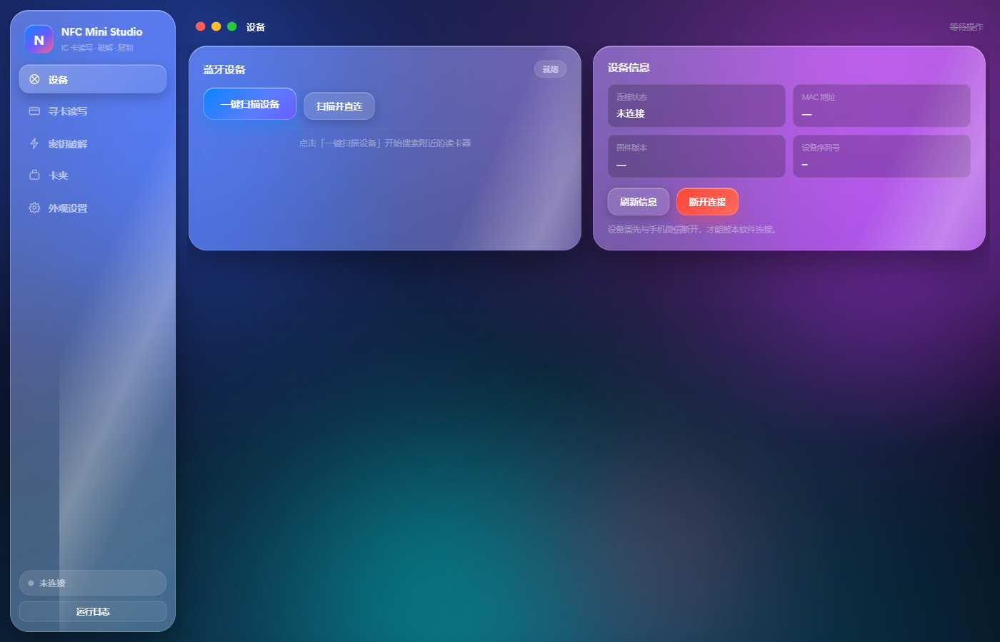

# NFC Mini Studio v3.1.0

把「NFC Mini 2.0 蓝牙读卡器」的完整能力搬到电脑上，并**额外打通两条通用通道**：

| 通道 | 硬件 | 说明 |
| --- | --- | --- |
| 🔵 蓝牙 BLE | 原厂 NFC Mini 2.0 读卡器 | 全功能：寻卡 / 读写块 / 整卡导出 / 密钥破解 / 写 UID / 写卡号 / 封卡 / 设备端侦测 / 固件信息 |
| 🟢 通用 PC/SC 读卡器 | ACR122U、ACR1252、PN532 串口转 CCID 等任意 PC/SC 标准读卡器 | 寻卡 / 读块 / 写块 / 密钥校验 / 写 UID / 写卡号 / 整卡导出 |
| 🔴 手机读卡器 | 任意带 NFC 的 Android 手机（本项目自带 APK） | 手机当读卡器，走 Wi-Fi TCP，能力同 PC/SC 通道 |

[](https://github.com/456erddgr/NFC-Mini-Studio/releases/latest)
[](LICENSE)
[](#安装)
[](#重新构建)
[](#手机当读卡器怎么用)

> 纯本地运行，不需要联网、不需要登录。云端密钥查询是**可选**功能，不开启也完全可用。

## 直接下载

去 **[Releases](https://github.com/456erddgr/NFC-Mini-Studio/releases/latest)** 下载，不用装 Python、不用编译：

| 文件 | 大小 | 说明 |
| --- | --- | --- |
| [`NFC_Mini_Studio_Setup_3.1.0.exe`](https://github.com/456erddgr/NFC-Mini-Studio/releases/latest/download/NFC_Mini_Studio_Setup_3.1.0.exe) | 118 MB | Windows 一键安装包，含完整运行环境，装完即用 |
| [`NFCMiniReader.apk`](https://github.com/456erddgr/NFC-Mini-Studio/releases/latest/download/NFCMiniReader.apk) | 4.2 MB | Android 手机读卡器 1.1.0，液态玻璃界面、本机读卡、换背景 |

> 安装包**没有做代码签名**，Windows SmartScreen 可能提示「已保护你的电脑」。
> 点「更多信息」→「仍要运行」即可，或者用下面的源码方式自己构建。

## 截图

<p align="center">
  
</p>

## Star 趋势

[](https://star-history.com/#456erddgr/NFC-Mini-Studio&Date)

---

## 目录

- [直接下载](#直接下载)
- [截图](#截图)
- [这是什么](#这是什么)
- [三种连接方式](#三种连接方式)
- [功能清单](#功能清单)
- [安装](#安装)
- [使用](#使用)
- [通用读卡器怎么用](#通用读卡器怎么用)
- [手机当读卡器怎么用](#手机当读卡器怎么用)
- [重新构建](#重新构建)
- [浅谈原理](#浅谈原理)
- [目录结构](#目录结构)
- [已知限制](#已知限制)
- [协议与逆向资料](#协议与逆向资料)

---

## 这是什么

NFC Mini 2.0 是一款国产 13.56 MHz / 125 kHz 双频 NFC 读写器，官方只提供微信小程序「宜新 NFC Reader Tool」作为上位机。本项目的目标是：

1. **把小程序的能力完整搬到 Windows 桌面**——不必再开微信、不必手机对着读卡器。
2. **不让能力被原厂硬件绑死**——只要你手上是 PC/SC 标准读卡器，也能读卡写卡。
3. **让手机本身变成读卡器**——没有读卡器但手机有 NFC？装个 APK 就能用。

界面是 macOS 观感的液态玻璃风格，原生 HTML/CSS/JS + Python 后端（pywebview 承载），单文件分发、开箱即用。

### 它与官方小程序的关系

本项目**不是**官方软件的破解版，是**协议层的独立实现**：

- 蓝牙通道：通过逆向 `__APP__.wxapkg` 得到私有二进制协议（帧格式、命令字、应答布局），自行实现上位机。
- PC/SC 通道：把同一套私有命令**翻译成标准 APDU**，用 `winscard.dll` 驱动通用读卡器。
- 手机通道：Android 端实现同一套私有命令的**服务端**，电脑端通过 TCP 与之通信。

三条通道对上层的 `NfcDevice` 提供完全一致的接口，因此寻卡、读卡、写卡、导出的业务代码一份就够。

---

## 三种连接方式

打开软件默认在「设备」页，顶部有三个分段按钮，切换后就看到对应通道的界面。

### 🔵 蓝牙原厂读卡器

```
电脑 --BLE--> NFC Mini 2.0 读卡器 --射频--> 卡片
```

- 服务 UUID `0000FFE0-0000-1000-8000-00805F9B34FB`
- 写特征 `0000FFE2-…`，通知特征 `0000FFE1-…`
- 连接前**请先让手机微信断开小程序**，否则蓝牙会被占用。
- 这是唯一支持「设备端破解」的通道（因为随机数采集必须由固件完成）。

### 🟢 通用 PC/SC 读卡器

```
电脑 --PC/SC--> ACR122U 等通用读卡器 --射频--> 卡片
```

- 依赖 Windows 的 Smart Card 服务（`SCardSvr`）。服务没启动时软件会直接告诉你，并给出一键修复命令。
- 电脑端把私有命令翻译成 `FF 82 / FF 86 / FF B0 / FF D6 / FF CA` 这组标准 APDU。
- 不支持「设备端破解」「读 125 kHz ID 卡」「封卡」——这些依赖原厂固件。

### 🔴 手机读卡器

```
电脑 --Wi-Fi TCP--> Android 手机 APK --NFC--> 卡片
```

- 手机装本项目 `android/NFCMiniReader.apk`，打开后点「启动读卡服务」。
- 手机每 1.5 秒广播 UDP 信标 `NFCMINI/1 <设备名> <ip> 8765` 到 8766 端口，电脑自动发现。
- 也可以手动填 `192.168.1.5:8765`。
- 手机和电脑必须在**同一局域网**，且路由器不能开「AP 隔离」。

---

## 功能清单

### 通用（三条通道都支持）

| 功能 | 说明 |
| --- | --- |
| 寻卡 | 识别 IC 卡 / UID 卡 / 7 字节 UID 卡 / 125 kHz ID 卡，读出 UID、SAK、卡类型 |
| 读块 | 单块读取，支持 KEY A / KEY B，自动处理扇区尾块 |
| 写块 | 三种写卡模式：极速 / 普通 / 带密钥类型，写前自动认证、写后自动校验回滚 |
| 密钥校验 | KEY A / KEY B 逐把验证，支持密钥库 |
| 整卡导出 | 一次读完整张卡（16 扇区 × 4 块），生成可分享的 JSON |
| 写 UID | 改写可写卡（UID 卡 / CUID / FUID）的 0 块，自动重算 BCC |
| 写卡号 | 写卡号到块 0（部分卡支持），写后可校验卡号 |
| 卡夹管理 | 卡片存档、重命名、导入导出、复制/粘贴/格式化 |
| 密钥库 | 收集、去重、批量验证、导出 |
| 差分对比 | 两张卡的扇区快照逐块对比，高亮差异 |
| 外观设置 | 壁纸、透明度、macOS 风格主题 |
| 离线自检 | 21 项自检，不联网也能验证核心逻辑 |

### 仅蓝牙原厂读卡器

| 功能 | 命令 | 说明 |
| --- | --- | --- |
| 设备端破解 | `0x20` / `0x22` / `0x30` / `0x32` / `0x37` | HardNested / 全卡解码 / 半解 / 静态 Nested / FM11RF08S |
| 设备端密钥表 | `0x40` / `0x41` | 批量搜密钥、批量认证，几百把密钥一次过 |
| 设备端侦测 | `0x34` / `0x35` / `0x36` | 抓取随机数用于离线破解 |
| 读 125 kHz ID 卡 | `0x26` | 读 EM4100 / TK4100 等低频卡 |
| 封卡（UFUID） | `0x17` / `0x23` | **不可逆**，封卡后无法再写 |
| 自动识别 | `0x38` | 自动判断卡类型并读卡号 |
| 设备信息 | `0x01` / `0x02` | 固件版本、SN、电量 |

### 软件端破解

不依赖设备也能算密钥：把「认证时的随机数交换」抓到后，用 **mfkey32** 算法离线穷举。软件内置：

- 本地破解（numba 加速，20 bit 约 0.1 秒）
- 云端 keygen（可选，需要原厂 token）
- 官方测试向量 5/5 通过

---

## 安装

### 方式一：安装程序（推荐）

从 [Releases](https://github.com/456erddgr/NFC-Mini-Studio/releases/latest) 下载
`NFC_Mini_Studio_Setup_3.1.0.exe`（118 MB）双击即可。

如果你是从源码构建的，产物在：

```
installer\dist\NFC Mini Studio 安装程序.exe
```

特性：

- 无边框液态玻璃界面
- 自定义安装位置（默认 `%LOCALAPPDATA%\Programs\NFC Mini Studio`）
- 桌面 / 开始菜单快捷方式
- 安装完立即启动
- **不需要管理员权限**
- 静默安装：`"NFC Mini Studio 安装程序.exe" --silent [--target D:\路径] [--launch]`

### 方式二：绿色版

自己构建 `python build_all.py app` 后，把整个文件夹拷走即可：

```
dist\NFC Mini Studio\NFC Mini Studio.exe
```

整个 `NFC Mini Studio` 文件夹拷到哪里都能跑，配置存在 `%APPDATA%\NFCMiniStudio`。

### 方式三：源码运行

需要 Python 3.10+（本项目在 3.14.3 上开发验证）。

```powershell
cd 项目根目录
python -m pip install -r requirements.txt
python run.py
```

---

## 使用

### 第一次使用

1. 双击打开软件。
2. 设备页顶部选通道（默认「蓝牙原厂」）。
3. 点「一键扫描设备」，等列表出现读卡器。
4. 点它连接。
5. 把卡贴近读卡器 → 点「寻卡」。

### 读卡

- 「寻卡」拿到 UID 后，可以点「读取整卡」一次读完，
- 也可以按扇区/块单独读。默认先用 `FFFFFFFFFFFF` 试，通了就用这把。

### 写卡

1. 先寻卡并读整卡（作为备份）。
2. 切到「写卡」，选写入模式。
3. 改要写的块，点「写入」。
4. 写入失败软件会自动回滚原内容（可关）。

> ⚠️ 写块 0、扇区尾块（控制块）有风险，可能把卡写坏。软件写前会提示。

### 破解密钥

有两条路：

- **设备端破解**（仅蓝牙原厂）：点「一键破解」，只支持 Mifare Classic 全加密卡。
- **软件端破解**：先用设备抓随机数，再用 mfkey32 离线算。抓不到随机数的卡（全加密）只能走设备端 HardNested。

---

## 通用读卡器怎么用

### 1. 启动 PC/SC 服务

Windows 的 Smart Card 服务默认是「手动」且常常没启动。在**管理员 PowerShell**里执行：

```powershell
sc config SCardSvr start= auto
net start SCardSvr
```

软件里也有「检测 PC/SC 环境」按钮，会直接告诉你服务起没起，还有「复制修复命令」一键复制上面两行。

### 2. 插上读卡器

任意 PC/SC 标准读卡器都行，比如：

- ACS ACR122U / ACR1252U（USB，免驱）
- ACS ACR122（串口）
- 各类 PN532 + CCID 固件模块
- 手机上装「NFC 卡模拟」通过 PC/SC 转发（不推荐）

插上后 Windows 设备管理器里会出现「智能卡读卡器」分类。

### 3. 软件里连接

设备页 → 选「通用读卡器」→ 点「检测 PC/SC 环境」确认服务正常 → 点「扫描读卡器」→ 选中你的读卡器 → 「连接」。

### 4. 能做什么

| 功能 | 支持 |
| --- | --- |
| 寻卡 / 读 UID | ✅ |
| 读块（KEY A / KEY B） | ✅ |
| 写块 | ✅ |
| 写 UID（0 块） | ✅ |
| 写卡号 | ⚠️ 取决于卡片是否允许写 0 块 |
| 整卡导出 | ✅ |
| 密钥校验 | ✅ |
| 设备端破解 | ❌ 无固件能力 |
| 读 125 kHz ID 卡 | ❌ 硬件不支持 |
| 封卡 | ❌ 保守拒绝 |

### 5. 原理简述

PC/SC 通用读卡器只认标准 APDU，不认原厂私有帧。所以软件在中间做了一层翻译：

```
上层业务（NfcDevice.request 发送私有帧）
        ↓
   PcscTransport._unframe()  拆出 (msgid, data)
        ↓
   PcscTransport._dispatch() 按命令字翻译成 APDU 序列
        ↓
   winscard.dll → 读卡器 → 卡片
        ↓
   结果按原私有协议格式拼回一个完整帧
        ↓
   self.on_data(reply)  回灌给上层，上层无感知
```

APDU 对应关系：

| 私有命令 | 对应 APDU |
| --- | --- |
| `0x06` / `0x09` 密钥校验 | `FF 82 00 00 06 <key6>` + `FF 86 00 00 05 <slot> 00 <block> <keyType> 00` |
| `0x07` 读块 | 同上认证 + `FF B0 00 <block> 10` |
| `0x08` / `0x16` / `0x18` 写块 | 同上认证 + `FF D6 00 <block> 10 <data16>` |
| 寻卡（读 UID） | `FF CA 00 00 00` 或按需 `FF B0 00 00 10` |
| 写 UID | 先 `FF D6 00 00 10 <uid4+bcc+sak+atqa>` |

---

## 手机当读卡器怎么用

> 详细说明（含权限、签名、协议、故障排查）：[`docs/Android读卡器.md`](docs/Android读卡器.md)

### 1. 装 APK

从 [Releases](https://github.com/456erddgr/NFC-Mini-Studio/releases/latest) 下载 `NFCMiniReader.apk`
（约 4.2 MB），传到手机安装。也可以：

```bash
adb install -r NFCMiniReader.apk
```

首次安装需要允许「安装未知应用」。**APK 1.1.0 起使用正式 release 签名**
（证书公开在 `android/keystore/`，谁都能重建出签名一致的包），
但从 1.0.0（debug 签名）升级会提示签名冲突，**先卸载旧版**即可。

系统要求：Android 5.0+（API 21），必须有 NFC 硬件。

### 2. 权限怎么给

NFC 权限是**安装时自动授予**的，不会弹窗。你只需要：

1. **手动打开系统 NFC 开关**（App 里有「去开启 NFC」直达按钮）
2. Android 13+ 会弹一次**通知权限**（前台服务需要），允许即可

其余网络/震动权限都是安装时授予。App 不联网、不收集任何数据。

> 为什么必须保持界面在前台？Android 的 NFC 轮询（reader mode）绑在 Activity 上，
> 界面一暂停读卡就停。前台服务能保住 TCP 连接，但保不住 NFC 轮询——这是系统限制。

### 3. 打开 App

打开后默认会**自动**：

- 检测 NFC 状态（没开会给直达按钮）
- 启动前台读卡服务（TCP 8765 端口，通知栏常驻）
- 开始广播 UDP 信标（8766 端口，让电脑能自动搜到）
- 屏幕常亮

界面上能看到：三个状态胶囊（NFC / 网络 / 卡片）、服务开关、`IP:端口`、连接数、本机读卡工具、背景设置、日志。

### 4. 手机端也能单独读卡

不连电脑也能用：

- **读取卡片信息** —— UID、SAK、ATQA、卡类型、扇区数/块数/容量
- **读扇区** —— 输入扇区号和密钥，直接看 4 个块的十六进制
- **复制 UID**

### 5. 电脑上连接

设备页 → 选「手机读卡器」→ 点「搜索手机读卡器」→ 列表里出现 `Pixel-8 · 192.168.1.5:8765` 就点它。

没搜到就点「手动输入地址」，填手机上显示的 IP + 端口。

### 6. 手机放卡

把卡贴到手机背面 NFC 天线位置（一般在摄像头附近）。电脑点「寻卡」就能读到。

> 手机 NFC 感应范围只有 1~3 cm，并且**要求卡静止不动**。读整卡时保持别动，否则会中断。

### 7. 能做什么

和 PC/SC 通道完全一致：寻卡、读块、写块、写 UID、写卡号、整卡导出、密钥校验。

不支持设备端破解、读 125 kHz ID 卡、封卡（手机 NFC 芯片只有 13.56 MHz 且不能生成随机数应答）。

### 8. 界面能换

- **液态玻璃**：壁纸 + GPU 实时高斯模糊（Android 12+）+ 半透明渐变卡片，可关
- **7 套内置渐变背景**：午夜蓝 / 极光 / 落日 / 深海 / 森林 / 石墨 / 雾玫
- **自己的照片当背景**：从相册选（不需要存储权限）
- **模糊强度 0~40**、**浅色/深色主题**、**端口可改**、**常亮/震动/自动启动**开关

### 9. 原理简述

手机端实现的是**服务端**，协议和原厂读卡器一模一样：

```
电脑 NfcDevice.request()
   ↓ 私有帧 FF|LEN|MSGID|DATA|SUM|FE
NetTransport.send()  →  TCP socket
   ↓
手机 ReaderServer 收到字节（先发一行 NFCMINI/1 握手文本）
   ↓ Protocol.Parser 拆帧
NfcEngine.dispatch(data)  →  调 Android NFC API 收发
   ↓ 按原 msgid 组回一个完整帧
TCP 回写  →  电脑 NetTransport.on_data()  →  FrameParser 解析
```

所以电脑端一行业务代码都没改，只换了 Transport 实现。

---

## 重新构建

### 装依赖

```powershell
python -m pip install -r requirements.txt
```

> 如果 pip 报权限错误（Windows 上常见），加 `--no-cache-dir`。

### 全量构建（主程序 + 安装程序）

```powershell
python build_all.py
```

### 只构建主程序

```powershell
python build_all.py app
```

### 只构建安装程序（需先有 installer\payload）

```powershell
python build_all.py installer
```

### 构建 Android APK

```powershell
python build_android.py            # release
python build_android.py --debug    # debug
python build_android.py --install  # 构建并 adb install
```

需要：

- JDK 17（`JAVA_HOME` 或 `C:\Program Files\Microsoft\jdk-17.0.19.10-hotspot`）
- Android SDK（`ANDROID_HOME` 或 `C:\Android\Sdk`，需 platform 34 + build-tools 34.0.0）
- Gradle 8.7（`GRADLE_HOME` 或 `C:\Android\gradle\gradle-8.7`）
- AGP 必须 **8.6.x**：AGP 8.7 要求 Gradle 8.9，而本项目用 Gradle 8.7

脚本会自动把工程镜像到 `C:\nfcmreader-build`（纯 ASCII 路径）再构建——Windows 用户名含中文时 AGP 会直接报
`Your project path contains non-ASCII characters`，而本项目路径里有「我的项目」四个字。
构建完把 APK 拷回 `android/NFCMiniReader.apk`。

签名：release 用 `android/keystore/nfcmini-release.jks`（公开的演示证书，密码在 `android/keystore.properties`）。
没有这个文件时自动退回 debug 签名。详见 [`docs/Android读卡器.md`](docs/Android读卡器.md) 第 4 节。

### 离线自检

```powershell
python run.py --selftest
```

21 项检查，报告写到 `%APPDATA%\NFCMiniStudio\selftest_report.txt`。

---

## 浅谈原理

### 1. 协议是从哪来的

官方小程序用 Taro + React 编译，逻辑全在 `app-service.js`。解包 wxapkg 后可以定位到 BLE 通信层：

```js
Object(c.i)(n, t, { opName: "get_device_info" })
```

`opName` 与命令字一一对应。再对照固件里的 `crypto01.c` / `mfkey32v2.c` 参考实现（项目 `_ref/` 下有），就能推出完整帧格式和应答布局。

详见 [`docs/原理说明.md`](docs/原理说明.md)。

### 2. 帧格式

短帧（DATA ≤ 255 字节）：

```
FF | LEN | MSGID | DATA... | SUM | FE
```

长帧（DATA > 255）：

```
FD | LEN_H | LEN_L | MSGID | DATA... | SUM | FE
```

- `SUM = sum(DATA) & 0xFF`（只累加 DATA，不含头尾）
- `MSGID` 递增 1..253，应答必须带回同一个 MSGID，请求/应答靠它配对

### 3. 三条通道怎么统一的

所有业务逻辑都走 `NfcDevice.request(data, timeout)`：组帧 → `transport.send()` → 等同一个 msgid 的应答帧。

所以只要实现一个 Transport，业务层完全不用改：

```python
class Transport:
    def open(self, **kw): ...
    def close(self): ...
    def send(self, frame: bytes): ...
    on_data: Callable[[bytes, str], None]   # 回完整帧字节
```

- `BleTransport`：切 180 字节分包走 BLE 写特征
- `PcscTransport`：拆帧 → 翻译成 APDU → 执行 → 按原格式拼帧回灌
- `NetTransport`：直接 TCP 吐字节

### 4. 密钥是怎么破的

Mifare Classic 的认证过程是一次「挑战-应答」：

```
读卡器 → 卡片： 随机数 nt
读卡器 ← 卡片： 加密的 nr、ar
读卡器 → 卡片： 加密的 at
```

如果读卡器用一把**错误**的密钥发起认证，卡片会先回 `nt` 再拒绝。设备把这几次的 `uid / nt / nr / ar / at` 记下来，就得到一组「nonce 对」。`mfkey32` 就是在一块很小的密钥空间里（48 bit 中已知 32 bit）反推出正确密钥。

本项目：

- 设备端用 `0x20 / 0x22 / 0x30 / 0x32` 采集
- 离线用 numba 加速的 `mfkey_local.py` 计算
- 官方测试向量 5/5 通过

### 5. 通用读卡器为什么能读出来

因为 PC/SC 是**上层协议**，底层还是 ISO14443-A。读块无非就是「认证 + 读二进制」，标准 APDU 完全够用。唯一缺的是「采集随机数」——那是原厂固件独有的旁路能力。

---

## 目录结构

```
NFC读卡工具NFCMiniStudio/
├── app/                     Python 后端 + 前端资源
│   ├── main.py              应用入口 / 窗口
│   ├── api.py               前端调用接口（111 个方法）
│   ├── device.py            设备业务层（寻卡/读写/破解/导出）
│   ├── protocol.py          私有协议编解码
│   ├── transport.py         蓝牙 BLE 传输
│   ├── transport_pcsc.py    通用 PC/SC 传输（APDU 翻译层）
│   ├── transport_net.py     手机读卡器传输（TCP）
│   ├── crack_engine.py      破解引擎
│   ├── mfkey_local.py       mfkey32 本地实现（numba 加速）
│   ├── keybox.py            密钥库
│   ├── store.py             卡片存档
│   ├── paths.py             路径解析（版本号唯一来源）
│   ├── selftest.py          离线自检
│   ├── wx_token.py          云端 token 获取
│   └── web/                 原生前端
│       ├── index.html
│       ├── js/app.js
│       ├── css/{style.css, macos.css}
│       └── assets/ wallpapers/
├── android/                 Android 手机读卡器工程（APK 1.1.0）
│   ├── NFCMiniReader.apk    预编译 APK（4.2 MB）
│   ├── keystore/            公开的演示签名证书
│   ├── app/src/main/java/net/nfcreader/minireader/
│   │   ├── MainActivity.java      界面 + 液态玻璃 + 换背景 + 本机读卡
│   │   ├── NfcEngine.java         私有命令 → Android NFC API（核心）
│   │   ├── ReaderServer.java      TCP 服务 + UDP 信标
│   │   ├── ReaderCore.java        单例：engine/server/settings
│   │   ├── ReaderService.java     前台 Service（后台存活）
│   │   ├── Protocol.java          帧编解码 + 状态码位置表
│   │   ├── DeviceInfo.java        设备名/SN/IP/电量
│   │   ├── AppSettings.java       设置持久化
│   │   └── WallpaperFactory.java  渐变壁纸 + 模糊 + 自定义图
│   └── app/src/main/res/
├── installer/               安装程序
│   ├── installer.py
│   ├── payload/             打包进安装程序的主程序
│   └── dist/                安装程序产物
├── dist/                    主程序产物
├── docs/                    详细文档
├── _ref/                    逆向参考（固件、算法源码、笔记）
├── tools/                   若干检查脚本
├── build_all.py             桌面端构建
├── build_android.py         APK 构建
├── requirements.txt
└── run.py                   源码启动入口
```

---

## 已知限制

1. **通用读卡器 / 手机读卡器不支持设备端破解**。原因：采集随机数需要固件配合，PC/SC 和手机 NFC API 都没有这个能力。
2. **读 125 kHz ID 卡只有原厂读卡器能做**。通用读卡器和手机 NFC 芯片都是 13.56 MHz。
3. **封卡不可逆**。`0x17` / `0x23` 一旦发出，卡就废了。软件在非蓝牙通道直接拒绝，蓝牙通道也有二次确认。
4. **手机读卡器感应距离短**（1~3 cm）且需要卡片静止，读整卡时手要稳。
5. **同一时间只能连一种通道**。切换通道会自动断开前一个。
6. **云端 keygen 依赖原厂服务**，原厂改接口就可能失效。软件在云端不可用时会自动降级到本地破解。

---

## 协议与逆向资料

- [`docs/原理说明.md`](docs/原理说明.md) — 架构、协议、三条通道实现细节
- [`docs/使用手册.md`](docs/使用手册.md) — 逐步图文操作
- [`docs/编译与打包.md`](docs/编译与打包.md) — 从源码到安装包/APK 全流程
- [`docs/Android读卡器.md`](docs/Android读卡器.md) — 手机读卡器 APK 完整说明（权限/签名/协议/FAQ）
- [`docs/常见问题.md`](docs/常见问题.md) — FAQ
- [`NFC_Mini_2.0_协议逆向报告.md`](NFC_Mini_2.0_协议逆向报告.md) — 原始逆向记录
- [`云端Token获取教程.md`](云端Token获取教程.md) — 可选云端功能配置

---

## 声明

本项目仅用于**学习协议与自有卡片管理**。请勿用于破解他人门禁、盗刷他人卡片。因使用不当造成的任何后果由使用者自负。

原始协议、固件、小程序著作权归原厂所有。本项目是独立实现的互操作层，不包含原厂固件代码。

## 许可证

MIT License，详见 [LICENSE](LICENSE)。
