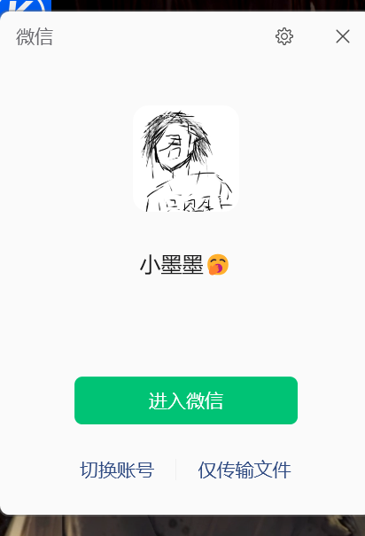

# 云端 token 获取教程（NFC Mini Studio）

> 适用版本：v2.7.0 起 ｜ 更新日期：2026-10-09

## 这个 token 是什么、为什么需要它

云端破解走的是厂商官方 recovery 接口，请求头里要带 **`NICETHEME`**，值就是你在微信小程序
「宜新 NFC Reader Tool」里的**登录态 token**（一串 JWT，约 1 天过期）。

它只能从**正在运行的小程序内存里**读出来，程序没法凭空生成，也不该预置固定值。

**为什么程序不帮你点？** 微信 4.x 是自绘渲染界面（Windows UI Automation 只暴露 2 个
节点），程序读不到里面的按钮；只能靠图像识别 + 模拟点击，维护成本高、换个窗口大小/DPI
就失效。所以现在改成：**程序负责打开微信、给出步骤、自动抓取；那几步点击由你来点**。

## 五步操作（照着点就行）

### 第 1 步：点开微信

在任务栏/桌面点开微信。如果出现的是登录页（显示你的头像、下面有绿色的「进入微信」），
先点那个绿色按钮。

### 第 2 步：点左侧的「小程序」图标

微信左侧竖排图标里那个**像罗盘的圆形图标**（平时是白色，点下去会变绿）。

### 第 3 步：点绿色的「小程序」

中间的「发现」列表里会出现一行**绿色**的「小程序」，点它。

### 第 4 步：点红色的 NFC 图标

右侧小程序列表里那个**红色圆形、带信号波纹**的图标，就是「宜新 NFC Reader Tool」。

### 第 5 步：回到 NFC Mini Studio 点「开始抓取 token」

小程序打开后（能看到它的界面就行，不一定要登录成功页面），回到本程序：

**破解页 →「云端解算」卡片 → 点「开始抓取 token」**，程序会自动读出登录态并填好。

> 程序也会在**每次启动时自动校验** token：本地先看 JWT 过期时间，再向厂商网关发一次
> 轻量探测。失效会弹窗询问，同意后就是上面这套流程。

## 常见问题

**Q：点了「开始抓取」一直失败？**

- 确认微信是**登录状态**（没登录就没有登录态）；
- 确认小程序**确实开着**（先手动打开一次，程序才能从内存里读到）；
- 抓取只认"剩余有效期够用"的 token；如果小程序里刚退出登录，先重新登录一次。

**Q：扫描不到读卡器 / 设备页一台设备都没有？**

小程序打开时会**自动连上读卡器并占用蓝牙**，这时桌面端扫不到它。
请在小程序里点「断开连接」（或关掉小程序窗口）后再扫描。
这不是 bug，是蓝牙独占。

**Q：token 多久过期？**

约 24 小时。每次启动程序都会自动校验；失效时点一次「开始抓取」即可，不用重新登录微信。

**Q：不想用云端，可以只用本地破解吗？**

可以。把破解模式切成「本地离线（mfkey32）」，就不需要 token，全程不联网。

## 相关技术说明（给开发者）

- token 读取：`app/wx_token.py` → 只读扫描 `WeChatAppEx.exe` 进程内存里的 UserLog，
  提取 `POST /login` 响应中的 `userInfo.token`；**不注入、不修改目标进程内存**。
- 有效性校验：`app/crack_engine.py::vendor_token_probe()`，用 `GET /get-devices`
  探测（同样要求 `NICETHEME`），并区分"网络不通"与"网关拒绝"。
- 拉起微信：`app/wx_token.py::launch_wechat()/focus_wechat()`
  （注册表 App Paths 找主程序；已收进托盘时用微信默认热键 `Ctrl+Alt+W` 叫出来，
  并用 `GetForegroundWindow` 校验是否真的切到前台）。
- 小程序清单接口：`app/api.py::wx_miniprogram_guide()`
  （appid `wxc3dd33d9d4ae0fd6`，界面与本文共用同一份步骤数据）。
